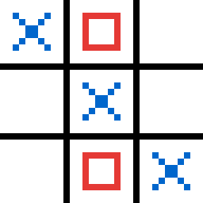
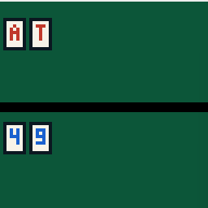
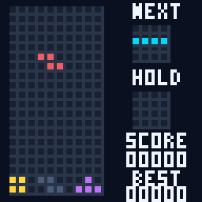

# MIPS Assembly Games

**Three interactive games built for SDSU CS 240 (Computer Organization): Tic-Tac-Toe, Blackjack, and Tetris.**

These games run in the **MARS MIPS simulator** and use MIPS assembly for game state, keyboard input, rules, and pixel graphics. Each game draws directly to the simulator's memory-mapped Bitmap Display and receives input through its Keyboard and Display MMIO Simulator.

## Games at a glance

| Tic-Tac-Toe | Blackjack | Tetris |
| :---: | :---: | :---: |
|  |  |  |
| Two-player, turn-based grid game | Single-player card game against a dealer | Falling-block game with scoring and piece previews |
| [`tic_tac_toe.asm`](tic_tac_toe.asm) | [`blackjack.asm`](blackjack.asm) | [`tetris.asm`](tetris.asm) |

## Requirements and setup

1. Open **MARS 4.5**, a MIPS assembly simulator, and open one `.asm` file from this repository.
2. Open **Tools > Bitmap Display** and configure it using the table below.
3. Open **Tools > Keyboard and Display MMIO Simulator**.
4. Connect both tools to MIPS using their **Connect to MIPS** buttons.
5. Assemble the program and press **Run**. Type gameplay keys into the MMIO simulator's keyboard field, **not** the MARS console.

| Bitmap Display setting | Tic-Tac-Toe | Blackjack | Tetris |
| --- | --- | --- | --- |
| Unit Width in Pixels | 8 | 4 | 4 |
| Unit Height in Pixels | 8 | 4 | 4 |
| Display Width in Pixels | 256 | 256 | 256 |
| Display Height in Pixels | 256 | 256 | 256 |
| Base address for display | `0x10010000` (static data) | `0x10010000` (static data) | `0x10010000` (static data) |

**For Blackjack and Tetris:** turn **delayed branching OFF**. The supplied source specifies these settings, and **Tetris should run at maximum simulation speed** for normal gameplay timing.

> All three programs depend on MARS's bitmap/MMIO tools and are **not standalone desktop games**.

## Tic-Tac-Toe

**File:** [`tic_tac_toe.asm`](tic_tac_toe.asm) | **Players:** 2 (local, alternating turns)

The game stores a 3×3 board in memory and draws blue Xs and red Os. It checks all eight winning lines, detects a draw after nine valid turns, and rejects invalid keys or moves into occupied squares.

**Controls**

| Key | Action |
| --- | --- |
| `1`–`9` | Place a mark in the corresponding grid cell (top-left to bottom-right) |
| `R` | Restart |
| `Q` | Quit |

**Manual test evidence:** X wins, O wins, tie, occupied-square input, and invalid key were documented in the submitted assignment.

## Blackjack

**File:** [`blackjack.asm`](blackjack.asm) | **Players:** 1 vs. dealer

This simplified Blackjack game uses a shuffled 52-card deck, deals two cards to each side, and hides the dealer's second card until the round resolves. Aces count as 11 unless reducing them to 1 is necessary to avoid a bust. The dealer draws below 17 and stands on 17, including soft 17. The program handles natural Blackjacks, wins, losses, busts, and ties.

**Controls**

| Key | Action |
| --- | --- |
| `H` | Hit (draw a card) |
| `S` | Stand (finish your turn) |
| `R` | Start a new round |
| `Q` | Quit |

**Scope:** no betting, splitting, or doubling down. A Fisher–Yates shuffle is used when starting each round.

**Manual test evidence:** hit, stand, bust, natural Blackjack, and invalid input were documented in the submitted assignment.

## Tetris

**File:** [`tetris.asm`](tetris.asm) | **Players:** 1

A 10×20 falling-block game with the seven standard tetromino shapes. The program stores the board and pieces in memory, checks collisions, rotates with basic horizontal wall kicks, clears completed rows, and updates the score. The display also includes a **ghost/landing guide, next-piece preview, hold slot, and best score for the current program session**.

**Controls**

| Key | Action |
| --- | --- |
| `A` / `D` | Move left / right |
| `W` | Rotate clockwise |
| `S` | Soft drop |
| `Space` | Hard drop |
| `C` | Hold or swap a piece (once per falling piece) |
| `R` | Restart |
| `Q` | Quit |

**Implementation details:** Pieces are selected from shuffled seven-piece bags. Gravity is set to approximately **650 ms per row**. Clearing 1, 2, 3, or 4 lines in one placement awards **100, 300, 500, or 800 points** respectively. The best score remains in program memory across restarts, but is not saved when MARS exits.

**Manual test evidence:** Gameplay and game-over screenshots are shown below and documented in the submitted assignment.

| Gameplay | Game over |
| :---: | :---: |
|  |  |

## What this project explores

- **Memory-mapped I/O:** reading keyboard input and writing display pixels through simulator-specific addresses.
- **Low-level state management:** board arrays, cards/pieces, counters, branching, and explicit control flow.
- **Subroutines and registers:** procedures for input, rules, graphics, scoring, and rendering, including stack/return-address handling.
- **Testing and edge cases:** checking invalid inputs and game-ending states, not just the normal gameplay path.

## Development and attribution

Created for **CS 240: Computer Organization at San Diego State University** (Assignment 4, October 2026).

For this assignment, I developed and tested three MIPS games, documented the mechanics and controls, and captured gameplay and edge-case evidence. **ChatGPT assisted substantially with writing, debugging, and refining the MIPS assembly code.** I used MARS to exercise the games and document the results in my submitted assignment. This repository presents that coursework and the resulting programs; it does not represent independently written production software or automated test coverage.

*The screenshots above come from the MARS test screenshots in my submitted assignment.*